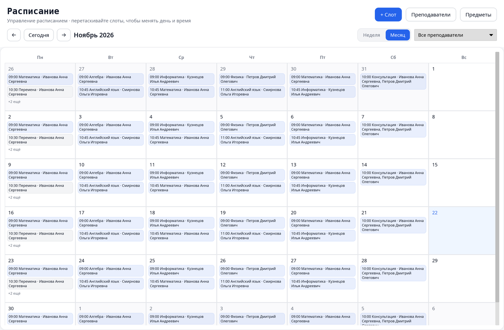
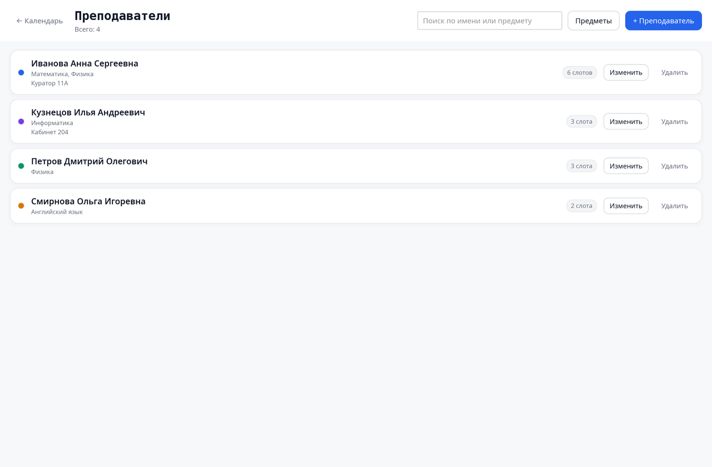
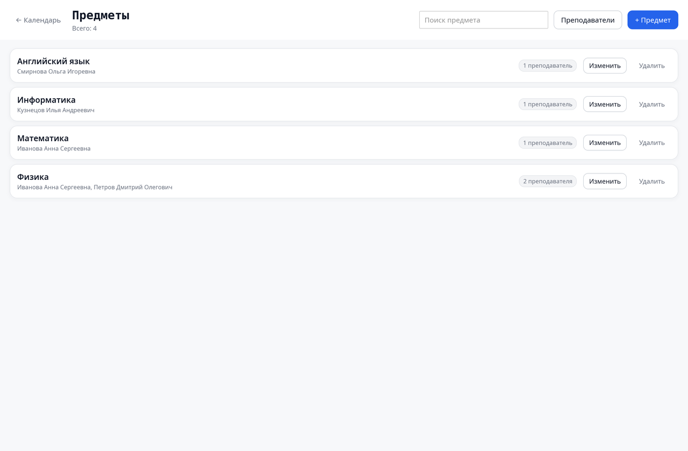
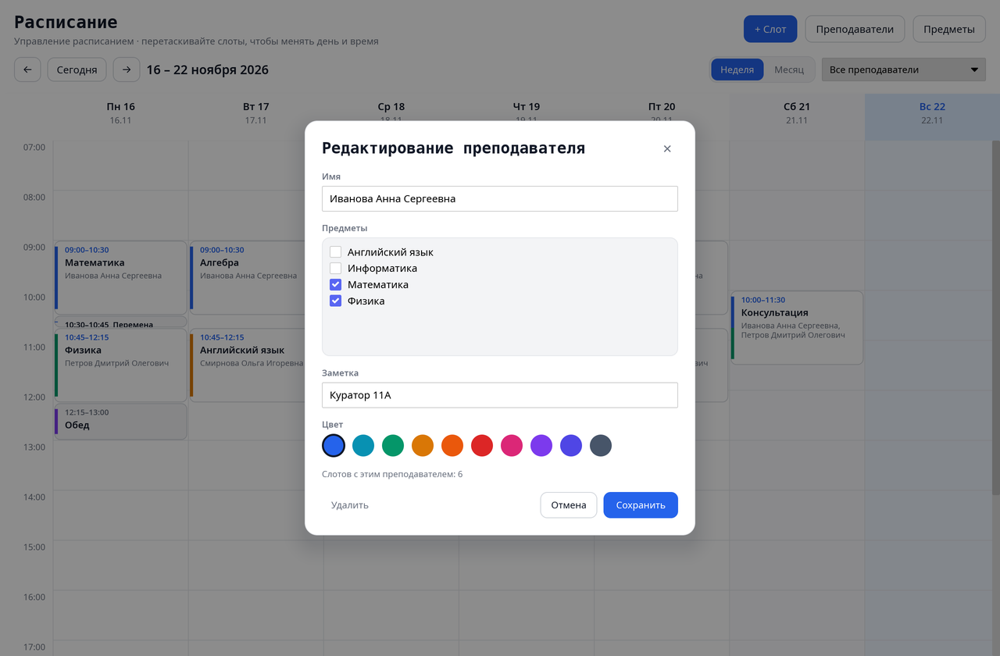
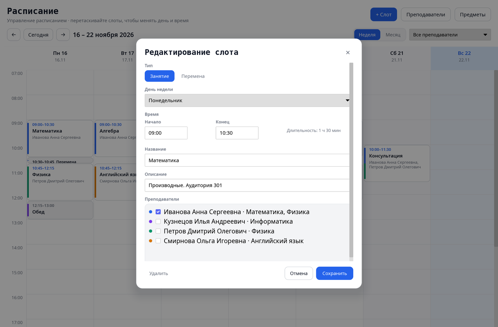

# Edu Scheduler — расписание преподавателей

Локальное **offline-first** десктопное приложение на Rust и Iced для управления недельным расписанием преподавателей. Без Tauri, Electron и WebView: нативное окно, встроенная SQLite, никаких сетевых запросов.


## Возможности

- **Преподаватели**: создание, редактирование, удаление, цвет, заметка, поиск и мультивыбор предметов.
- **Предметы**: отдельный CRUD-справочник; один преподаватель может вести несколько предметов.
- **Слоты**: занятие или перемена, день недели, время начала и конца, название, описание и несколько назначенных преподавателей.
- **Drag-and-drop**: перетаскивайте слоты по недельной сетке, чтобы менять день и время; конфликты блокируются.
- Слот повторяется **каждую неделю** в выбранный день недели.
- **Недельный календарь**: сетка Пн–Вс, прокрутка по времени, цветные карточки, параллельные слоты в отдельных колонках, подсветка сегодняшнего дня.
- **Месячный календарь**: все вхождения недельного шаблона, компактные карточки, переход к неделе по клику на день.
- **Фильтр по преподавателю** в обоих видах календаря.
- **Проверка конфликтов**: один преподаватель не может находиться в двух пересекающихся слотах.
- Данные хранятся локально в SQLite; удаление преподавателя снимает его со слотов, но не удаляет сами слоты.
- Русский интерфейс, встроенный шрифт Noto Sans.

| Месяц | Преподаватели |
| --- | --- |
|  |  |

| Предметы | Мультивыбор предметов |
| --- | --- |
|  |  |



## Стек

- Rust 2024, MSRV 1.88
- [Iced 0.14](https://iced.rs) (canvas для недельной сетки, wgpu с fallback на tiny-skia)
- SQLite через `rusqlite` с фичей `bundled` (сборка не требует системного SQLite)
- `chrono`, `directories`, `thiserror`, `image`

## Запуск

```bash
cargo run
```

При первом запуске создаётся файл `schedule.db` в каталоге данных приложения:

- macOS: `~/Library/Application Support/ru.v-aleks.edu-scheduler/schedule.db`
- Linux: `~/.local/share/edu-scheduler/schedule.db`

Путь можно переопределить:

```bash
cargo run -- --db /path/to/schedule.db
# или
EDU_SCHEDULER_DB=/path/to/schedule.db cargo run
```

Переменная `EDU_SCHEDULER_DB` задаёт значение по умолчанию, аргумент `--db` имеет приоритет.

База обновляется автоматически. При переходе со старой версии предметы преподавателей переносятся в справочник `subjects`, а связи сохраняются в `teacher_subjects`.

### Перетаскивание слотов

В недельном виде нажмите на карточку слота и перетащите её на другой день или время. Время привязывается к сетке с шагом 15 минут, длительность сохраняется. Если у назначенных преподавателей возникает конфликт, перенос отменяется и показывается ошибка. Короткий клик без перетаскивания открывает редактор слота.

### Горячие клавиши

- `Esc` — закрыть модальное окно или баннер.
- `Cmd/Ctrl + N` — новый слот.
- `Cmd/Ctrl + Q` — выход.

### Служебные команды

```bash
cargo run -- --help
cargo run -- --version
```

`--screenshot <path>` (и `EDU_SCREENSHOT`) сохраняет снимок окна после запуска и завершает приложение — используется для документации и проверки вёрстки.

## Разработка

```bash
cargo fmt --check
cargo clippy --all-targets -- -D warnings
cargo test
```

Тесты покрывают доменную валидацию, конфликты, даты и месячную сетку, SQLite-миграции (включая перенос старых предметов в отдельный справочник), CRUD преподавателей/предметов/слотов, drag-and-drop и логику обновления состояния (создание/редактирование/удаление, фильтр, навигация).

### Требования

- macOS: Xcode Command Line Tools.
- Linux (сборка): `pkg-config`, `libxkbcommon-dev`, `libwayland-dev`, `libx11-dev`.
- Linux (запуск): `libxkbcommon0`, `libfontconfig1`, `libx11-6`, `libwayland-client0`, `libvulkan1` или `libgl1`.

## Сборка пакетов

### macOS

```bash
./scripts/package-macos.sh
```

Скрипт собирает `.app`, подписывает ad-hoc, создаёт `.app.zip`, а также DMG с ярлыком `/Applications` в `dist/`. Если окружение не поддерживает создание DMG, остаётся `.app.zip`. Сборка не подписана сертификатом Apple и не нотаризована. На macOS при первом запуске может потребоваться:

- открыть приложение через правый клик → «Открыть»;
- или снять quarantine-флаг:

```bash
xattr -dr com.apple.quarantine "/Applications/Edu Scheduler.app"
```

Для Intel Mac можно собрать бинарник с `cargo build --release --target x86_64-apple-darwin`; скрипт упаковки использует текущую архитектуру.

### Linux

```bash
./scripts/package-linux.sh
```

Скрипт создаёт `.deb` и переносимый `.tar.gz` в `dist/`.

```bash
sudo dpkg -i dist/edu-scheduler_0.1.0_amd64.deb
edu-scheduler
```

### CI

- `.github/workflows/ci.yml` — форматирование, clippy и тесты на macOS и Ubuntu.
- `.github/workflows/release.yml` — по тегу `v*` или вручную собирает DMG/zip на macOS и deb/tar.gz на Ubuntu, затем загружает артефакты.

## Структура проекта

```
src/
  app/          состояние, сообщения и update-логика
  db/           SQLite, миграции и репозиторий
  domain/       модель, валидация, конфликты, русские даты
  ui/           тема, строки, календарь, экраны и модальные окна
assets/         шрифты, иконки
packaging/      Info.plist и .desktop
scripts/        упаковка macOS и Linux
docs/           скриншоты
```

## Ограничения текущей версии

- Один пользователь и один локальный файл БД; синхронизации и совместной работы нет.
- Нет исключений на конкретные даты: расписание циклическое, по дням недели. Перенос слота меняет его день и время для всех недель.
- Нет аудиторий, групп и учеников; название и описание принадлежат слоту.
- У предмета есть только название: цвет, часы и другие атрибуты не ведутся.
- Описание слота — однострочный текст.
- Часовые пояса не учитываются: используется локальное время.
- Нет проверки пересечений между разными преподавателями — параллельные занятия разрешены.
- Импорт/экспорт и резервное копирование не реализованы.
- Сборки macOS не подписаны и не нотаризованы.

## Лицензии

Код лицензирован по MIT (см. [LICENSE](LICENSE)). Шрифт Noto Sans распространяется по SIL Open Font License; текст лицензии — в [assets/fonts/OFL.txt](assets/fonts/OFL.txt).
